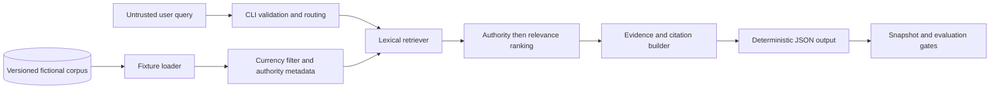

# Architecture — deterministic enterprise RAG slice

## Problem and scope

Enterprise search must return inspectable evidence without allowing stale or
unofficial material to silently become an answer. This portfolio slice proves
a smaller claim than a production RAG platform: a fictional, local corpus can
be searched deterministically, with citations derived only from returned
evidence and no network, credentials, vector database, or LLM.

## Request flow

The `demo` command loads the allowlisted local fixture, excludes non-current
documents, ranks remaining sources by authority and lexical overlap, and emits
evidence plus citations. The separate `agent` command adds a deterministic
`retrieve`/`abstain` decision and only copies an answer sentence from evidence.

## Trust and security boundaries

- **Untrusted input:** the query influences token matching only. It is never
  executed, used as a path, or sent to a remote service.
- **Trusted, reviewable input:** versioned fictional fixtures are the only
  corpus. Evaluation corpus selectors are allowlisted; evaluation content
  cannot provide arbitrary filesystem paths.
- **Governance boundary:** non-current sources are removed before ranking and
  authority outranks lexical relevance. The adversarial fixture verifies both
  controls under conflicting evidence.
- **Output boundary:** citations are constructed from retrieved evidence IDs.
  The extractive agent either returns a sentence present in cited evidence or
  abstains with no answer and no citations.
- **Operational limit:** this is an offline baseline, not an authentication,
  authorization, prompt-injection, production-load, or model-quality claim.

## Verifiable results

| Claim | Reproducible check |
| --- | --- |
| Public demo matches executable behavior | `python3 -m unittest tests.test_public_artifacts -v` regenerates `docs/demo-output.json` through the real CLI and compares stdout byte-for-byte. |
| Retrieval quality and budgets pass | `PYTHONPATH=src python3 -m enterprise_rag.cli evaluate` checks versioned recall, latency, and zero external cost. |
| Answers are grounded or safely abstain | `PYTHONPATH=src python3 -m enterprise_rag.cli evaluate-agent` checks exact evidence support, decisions, and adversarial cases. |
| Full offline contract remains healthy | `PYTHONPATH=src python3 -m unittest discover -s tests -v` runs all standard-library tests. |

The saved [sanitized demo output](demo-output.json) uses only fictional fixture
data and is regenerated with the exact command shown in the README.
